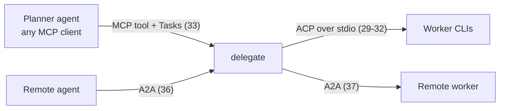

# delegate — roadmap

What the tool does, what is built, and what is left. Each remaining item is a
self-contained card, so you can pick one up at any point and code it by hand.

Design and contracts: [design.md](design.md). Planner-side skill:
[skills/delegate/SKILL.md](../skills/delegate/SKILL.md).

## How to jump in

1. Pick a card below (⬜ = not started).
2. Tell Claude the card number and a pairing mode:
   - **mode 1**: you drive, Claude reviews and hints
   - **mode 2**: Claude writes one failing test, you make it pass
   - **mode 3**: Claude writes it, you explain every line back
3. Each card lists the files, the test seam, and the Go idioms you will practise.

Every card ends the same way: `make check` green, then a commit.

## Features

| Feature | Status |
|---|---|
| Run any agent CLI from a profile, with `{prompt}` substitution | ✅ v1 |
| Non-zero exit is a result, not an error; missing binary is an error | ✅ v1 |
| Per-profile timeout; `--timeout` override | ✅ v1 |
| stdout and stderr captured separately and saved to a log dir | ✅ v1 |
| Worker summary from `<delegate-summary>`, fallback to the last 20 lines | ✅ v1 |
| Built-in profiles: `cursor` (default), `claude-sonnet` | ✅ v1 |
| Isolated git worktree per run on branch `delegate/<run-id>` | ✅ v1 |
| `--in-place` mode, refused on `main`/`master` | ✅ v1 |
| Files changed and diffstat, including new and committed files | ✅ v1 |
| One-line JSON result; `status` ok, failed, timeout or error | ✅ v1 |
| Claude Code skill: plan → delegate → review → report, one round | ✅ v1 (in repo, not installed) |
| `delegate profiles` | ✅ |
| `delegate doctor` | ✅ |
| `delegate skill install` | ✅ card 9c |
| YAML config merged over the built-ins | ✅ card 11 |
| Large prompts via stdin | ✅ card 12 |
| Clean up old worktrees and runs | ✅ card 13 |
| Codex and Gemini profiles, verified | ⏸ card 14 (parked 2026-11-11) |
| Dirty-repo warning in the result | ✅ card 15 |
| Public release | ✅ card 16 |
| Recursion guard: a worker cannot start its own delegate run | ✅ card 17 |
| `--verify`: delegate runs the acceptance commands itself | ✅ card 18 |
| File allowlist in the plan; `out_of_scope` in the result | ✅ card 19 |
| Plan check: refuse a plan without Goal, Steps, Acceptance criteria | ✅ card 20 |
| Cost, tokens and review verdict recorded per run | ✅ card 21 |
| `claude-haiku` profile | ✅ card 22 |
| Skill: plans give paths and line ranges, not pasted code | ✅ card 23 |
| `repo` and `started_at` in `result.json` | ✅ card 24 |
| Worker isolated from the user's Claude setup | ✅ card 25 |
| `needs_input` status when the worker hits an ambiguity | ✅ card 26 |
| Installed profiles named when a CLI is missing | ✅ card 27 |
| Cost and tokens per **accepted** run in `stats` | ⬜ card 28 |
| ACP worker transport (one protocol instead of per-CLI flags) | ⬜ card 29 |
| One permission policy, answered by delegate for every worker | ⬜ card 30 |
| `--events`: compact progress stream while the worker runs | ⬜ card 31 |
| `delegate resume`: answer a `needs_input` run in the same worktree | ⬜ card 32 |
| `delegate mcp`: delegate as an MCP server, long runs as MCP Tasks | ⬜ card 33 |
| Best-of-N: parallel runs, each verified, ranked | ⬜ card 34 |
| Escalation ladder named by the caller | ⬜ card 35 |
| `delegate a2a serve`: delegate as an A2A agent | ⬜ card 36 |
| Remote A2A agent as a worker | ⬜ card 37 |

## v1 slices (done)

| # | Slice | Code | Written by |
|---|---|---|---|
| 1 | Run a command with `{prompt}`, capture stdout | `internal/runner/runner.go` | Alain (mode 2) |
| 2 | Exit code as a result; missing binary as an error | `internal/runner/runner.go` | Alain (mode 2) |
| 3 | Timeout via `context` | `internal/runner/runner.go` | Alain (mode 2) |
| 4 | stderr captured separately | `internal/runner/runner.go` | Alain (mode 2) |
| 5 | Summary extraction plus fallback | `internal/runner/summary.go` | Alain (block), Claude (fallback) |
| 6 | Built-in profiles and `Lookup` | `internal/config/config.go` | Claude (mode 3) |
| 7 | Worktree, files changed, diffstat | `internal/workspace/workspace.go` | Claude (mode 3) |
| 8 | `delegate run` end to end, JSON, run ID, log dir | `cmd/delegate/run.go` | Claude (mode 3) |
| 10 | Skill | `skills/delegate/SKILL.md` | Claude (mode 3) |

### Explain-back checklist for Claude-written code (mode 3)

Answer each in one or two sentences, out loud or in chat:

1. `config.Builtin()` returns a new map on every call. What would go wrong with a package-level map var?
2. `config.Lookup` sorts the known names before printing them. Why does an error message need a stable order?
3. `workspace.Changes` runs `git add --intent-to-add --all` first. What would `files_changed` miss without it?
4. Why does `Changes` diff against `Base` and not `HEAD`? (Hint: the worker may commit.)
5. `Prepare` uses `rev-parse --show-toplevel`. What breaks if you pass `--repo ./internal`?
6. `execute` returns status `error` as JSON instead of returning a Go `error`. Who benefits?
7. `runTask` returns 2 for flag mistakes and 1 for run failures. Why keep them different?
8. Why is the worktree **not** deleted after a run?
9. `main` uses `signal.NotifyContext`. Follow Ctrl-C: how does it reach the worker process?
10. `gittest.InitRepo` sets `GIT_CONFIG_GLOBAL=/dev/null`. What could your own git config break in a test?

## Next: first real use (about 15 minutes)

1. `make install`, then check `delegate version` works from any directory.
2. Install the skill as a **copy** (never a symlink into this repo): `delegate skill install`.
3. In a real repo on a feature branch with a clean tree, ask Claude Code: `delegate <small task>`.
4. Note what felt wrong; each issue becomes a card below.

## Backlog cards

### 9a ✅ `delegate profiles` (about 20 minutes, good first card)

List the profiles and whether each binary is on `PATH`.

- Files: `cmd/delegate/profiles.go`, `cmd/delegate/profiles_test.go`
- Seam: `runCommands(ctx, []string{"profiles"}, &out, &errOut, profiles)`
- Test idea: a fake profile with `Command: "sh"` shows `found`; one with `Command: "no-such-bin"` shows `missing`.
- Idioms: `exec.LookPath`, `text/tabwriter`, `slices.Sorted(maps.Keys(m))`.

### 9b ✅ `delegate doctor` (about 30 minutes)

Check that `git` is on `PATH`, the state dir is writable, and the default
profile's binary exists. Print one line per check; exit 1 if any check fails.

- Files: `cmd/delegate/doctor.go`, `cmd/delegate/doctor_test.go`
- Idioms: a slice of `struct{ name string; check func() error }`, `errors.Join`.

### 9c ✅ `delegate skill install` (about 30 minutes)

Done 2026-11-10. A `.installed.sha256` next to `SKILL.md` records what
delegate wrote, so an untouched copy upgrades and edited or foreign copies
need `--force`. `doctor` warns (exit 0) on a missing or stale skill.

Embed `skills/delegate/SKILL.md` into the binary and copy it to
`~/.claude/skills/delegate/SKILL.md`. Copy, never symlink. Refuse to overwrite a
changed file unless `--force` is passed.

- Files: `skills/embed.go` (`//go:embed delegate/SKILL.md`), `cmd/delegate/skill.go`
- Seam: pass the target dir in, so tests use `t.TempDir()`.
- Idioms: `embed`, `os.MkdirAll`, `bytes.Equal` to detect changes.
- Then replace the `install-skill` Makefile target with this command.
- Also add a `doctor` check: `installed skill matches binary` (warn, not fail,
  when they differ). On 2026-10-23 the installed copy had silently fallen
  behind the repo (it still used `git add -A` and `branch -D`); this check
  would have caught it.

### 11 ✅ YAML config (about 1 hour)

Done 2026-11-10 with one deliberate change: the repo file may only set
`default_profile` and timeouts (least privilege: a cloned repo must not pick
the executable or its args). Profiles name their parser with `output:`.

Load `~/.config/delegate/config.yaml` and `<repo>/.delegate.yaml` and merge them
over `config.Builtin()`. Format: see design.md § Config.

- Files: `internal/config/load.go`, `internal/config/load_test.go`
- Seam: `config.Load(paths ...string) (Config, error)` with temp files.
- Cases: no file means the built-ins; a file adds a profile; a file overrides
  one field of a built-in; `default_profile`; a bad duration is an error naming
  the file and key.
- Idioms: `gopkg.in/yaml.v3` struct tags, `errors.Is(err, fs.ErrNotExist)`,
  `time.ParseDuration`.

### 12 ✅ Large prompts via stdin (about 30 minutes)

Done 2026-11-10. `prompt_via: arg|stdin` in the config; the built-ins now use
stdin (both CLIs verified reading it). Real runs: a 2 MiB prompt through a
`wc -c` profile, plus cursor and claude-haiku creating a file.

macOS caps argv at about 1 MB. Add `PromptVia string` ("arg" or "stdin") to
`runner.Profile`; with "stdin", set `cmd.Stdin = strings.NewReader(task.Prompt)`.

- Files: `internal/runner/runner.go`, `runner_test.go`
- Test: profile `cat` with `PromptVia: "stdin"` returns the prompt as `Output`.

### 13 ✅ `delegate clean` (about 45 minutes)

Done 2026-11-10, deliberately safer than sketched: `git worktree remove`
without `--force` and `git branch -d`, never `-D` (an unmerged `delegate/*`
branch may hold unaccepted work); logs only with `--logs`, because `stats`
reads them; worktrees whose source repo is gone are reported, not deleted.
First real preview: 2 removable (183 MB), 1 orphan, 14 old log dirs.

Remove worktrees, `delegate/*` branches and run logs older than N days. This is
destructive, so it shows what it would remove and needs `--yes` to act.

- Idioms: `os.ReadDir`, `fs.FileInfo.ModTime`, `git worktree remove`, `git branch -D`.
- State on 2026-10-23: 3 leftover worktrees, 21 MB.

### 14 ⏸ Codex and Gemini profiles (personal laptop only)

Parked 2026-11-11: not planned for now. Card 29 may make it smaller (Codex
has an ACP adapter, `codex-acp`), but that is UNVERIFIED until a real run.

Blocked on the work laptop: only Claude and Cursor are allowed there. The
personal laptop has Codex and Gemini but no Claude or Cursor, so this one is
done there by hand. Read `codex --help` and `gemini --help`, write a user
config profile for each (no code change needed since card 11), smoke-test each
with a one-line task, and record the verified snippet in design.md. A built-in
profile only after a real run.

### 15 ✅ Dirty-repo warning (about 20 minutes)

A new worktree starts from HEAD, so uncommitted work is invisible to the
worker. Add `"dirty": true` to the result when `git status --porcelain` is
non-empty in the source repo.

- Files: `internal/workspace/workspace.go` (`Workspace.Dirty`), `cmd/delegate/run.go`

### 16 ✅ Public release (about 1 hour)

State 2026-11-10: the repo was already public, so the history check came first.

- ✅ `AGENTS.md`, plus a `CLAUDE.md` containing `@AGENTS.md`.
- ✅ README: install, usage, JSON example, skill install (already there; now links AGENTS.md).
- ✅ `gitleaks git` over all 54 commits: no leaks. History grep for company names,
  internal hosts, ticket keys and local paths: only commit `d1d10fb` (lint/pre-commit
  comments naming two internal linters and a private golangci-lint fork), already
  removed from the tree by `7bd6ac7`. Left in history: rewriting a public history
  needs a force push and the content is not secret.
- ✅ `delegate version` reports the tag for `go install ...@v0.1.0` (no ldflags
  there; falls back to the module version in the build info).
- ✅ Tag `v0.1.0` on 2026-11-11 (`da7dfea`). Checked: `go install github.com/afplana/delegate/cmd/delegate@v0.1.0`
  through proxy.golang.org prints `v0.1.0`. goreleaser skipped: `go install` covers
  the Go audience; add it when someone asks for binaries.
- ✅ Repo visibility: already public.

### 17 ✅ Recursion guard (about 30 minutes)

Done 2026-11-10 in mode 3 (Claude wrote it; on Alain's explain-back list).
The optional second layer (blocking the skill in the claude profile args) was
not added: the env guard already covers every CLI.

A worker is a full agent session (`claude -p` loads your user skills, including
`delegate`), so a plan saying "delegate X" could make the worker start its own
worker. Not seen so far (checked 2026-10-14), but cheap to prevent.

Guard inside delegate itself, so it works for every CLI and stays role-agnostic:

1. `runner.Run` passes `DELEGATE_RUN_ID=<run id>` to the worker
   (`cmd.Env = append(os.Environ(), ...)`; add a `Task.Env` or `RunID` field).
2. `delegate run` refuses to start when `DELEGATE_RUN_ID` is already set:
   `status: error`, `error: "nested delegate run inside run <id>"`.

- Files: `internal/runner/runner.go`, `cmd/delegate/run.go`, their tests.
- Test seams: a profile `sh -c 'echo $DELEGATE_RUN_ID'` returns the id in `Output`;
  `t.Setenv("DELEGATE_RUN_ID", "outer")` then `runCommands(... "run" ...)` returns status `error`.
- Idioms: `os.Environ`, `cmd.Env`, `os.LookupEnv`, `t.Setenv`.
- Optional second layer: block the skill in the `claude-sonnet` profile args.
  Check `claude --help` for the exact disallowed-tools syntax first (UNVERIFIED).

## Accuracy and efficiency cards (from the 2026-10-23 run review)

Evidence: the 10 runs in `~/.local/state/delegate/runs` up to 2026-10-23. Nine
ended `ok`, one `failed` (Cursor `--force` disabled by an admin, fixed in
`2f2542b`). Every successful run wrote the `<delegate-summary>` block. Weak
spots: in 2 runs the worker's output never mentions a test command, one run
touched 18 files, and nothing records cost or how the review went. Highest
payoff first.

### 18 ✅ `--verify "<cmd>"` (about 45 minutes)

Run the acceptance commands **after** the worker exits, in the workdir, and put
the outcome in the result: `"verify": {"cmd": "...", "exit": 0, "tail": "..."}`
(last 30 lines of combined output). The result no longer depends on the worker
saying it ran the tests, and a red run costs the planner one JSON line instead
of a full diff review. Repeatable flag: `--verify "go test ./..." --verify "make lint"`.
`status` stays the worker's status; verify is a separate field.

- Files: `cmd/delegate/run.go`, `internal/runner/verify.go`, tests.
- Seam: `runVerify(ctx, dir string, cmds []string) []VerifyResult`; test with
  `sh -c 'exit 3'` and `sh -c 'echo ok'` in `t.TempDir()`.
- Idioms: `exec.CommandContext` with `cmd.Dir`, `CombinedOutput`,
  `errors.As(err, &exitErr)` for the exit code, a flag type implementing
  `flag.Value` for the repeatable flag.
- Skill follow-up: pass the plan's acceptance commands as `--verify`; the
  planner still re-runs them during review (evidence policy), but stops early
  on a red verify.

### 19 ✅ File allowlist and `out_of_scope` (about 45 minutes)

The plan gets a `# Files` section: one path or glob per line. After the run,
every entry of `files_changed` that matches none of them goes into
`"out_of_scope": [...]`. Catches the most common drift (the 18-file run) without
reading code. No `# Files` section means no check, so old plans still work.

- Files: `internal/plan/plan.go`, `cmd/delegate/run.go`, tests.
- Parser already exists (built with card 20): `plan.Parse(md).Section("Files")`
  returns the body. Add `OutOfScope(changed, allowed []string) []string`.
- Cases: exact path, `internal/**` glob, a file outside both, empty section.
- Idioms: `bufio.Scanner`, `strings.HasPrefix` for headings,
  `path.Match` (note: no `**`; handle a trailing `/**` as a prefix match yourself).

### 20 ✅ Plan check before the worker starts (about 30 minutes)

`delegate run` refuses a plan missing a `# Goal`, `# Steps` or
`# Acceptance criteria` heading: `status: error`,
`error: "plan missing sections: Steps, Acceptance criteria"`. The skill names
ambiguity as the main cause of drift; this makes it impossible to hand over a
plan without acceptance criteria. Built before card 19, so it added the
parser (`plan.Parse`, `Section`, `Missing`); `Parse` returns no error because
parsing markdown can't fail.

- Files: `internal/plan/plan.go`, `cmd/delegate/run.go`, tests.
- Seam: `Plan.Missing() []string`.
- Idioms: table-driven tests, `slices.Contains`.

### 21 ✅ Cost, tokens and review verdict per run (about 1 hour)

State 2026-11-10: usage done. Profiles carry a `Parse` func
(`runner.ParseClaudeJSON` / `ParseCursorJSON`); the Cursor shape is from a real
run, the Claude shape re-checked live on 2026-11-10 from a plain terminal
(`result`, `total_cost_usd` 0.0111, `usage.input_tokens` 2 for a haiku
"reply ok"; Claude Code's MCP-policy warnings go to stderr, so stdout stays
valid JSON).
`delegate review` and `delegate stats` added the same day (`internal/history`);
first real `stats` over 35 runs: cursor 27, claude-sonnet 6, claude-haiku 2,
no verdicts yet.

Record what each run cost and whether its result was accepted, so the choice
between Cursor and Sonnet rests on data (today: 4 Cursor runs, 6 Sonnet runs,
no quality data).

- Switch both profiles to `--output-format json` (verified 2026-10-23):
  - `claude -p --output-format json` → `total_cost_usd`, `duration_ms`,
    `num_turns`, `usage.{input_tokens,output_tokens,cache_read_input_tokens,...}`;
    the reply text is in `result`.
  - `cursor-agent -p --trust --output-format json` → `usage.{inputTokens,outputTokens,cacheReadTokens,cacheWriteTokens}`,
    `duration_ms`, reply text in `result`. **No cost field.**
- Add `"usage": {"input_tokens", "output_tokens", "cost_usd"}` to `result.json`
  (`cost_usd` omitted for Cursor). Summary extraction now reads the JSON
  `result` field instead of raw stdout.
- New subcommand `delegate review <run-id> accepted|needs-fixes|failed [note]`
  writes `runs/<id>/review.json`. The skill calls it after the user decides.
- Later: `delegate stats` aggregates per profile (runs, accept rate, median
  tokens, cost).
- Files: `internal/config/config.go`, `internal/runner/summary.go`,
  `cmd/delegate/review.go`, tests.
- Idioms: `json.Unmarshal` into a small struct per profile shape,
  `omitempty`, a `Parse func([]byte) (Usage, string, error)` field on `Profile`.

### 22 ✅ `claude-haiku` profile (about 10 minutes)

One entry next to `claude-sonnet` in `internal/config/config.go:23`, using
`claudeArgs("haiku")`. For Tier C work in `~/.claude/CLAUDE.md` model routing:
renames, mechanical sweeps, fully specified edits.

- Test: `Lookup("claude-haiku")` returns `--model haiku`.

### 23 ✅ Skill: paths and line ranges, not pasted code (about 15 minutes)

`skills/delegate/SKILL.md` § Plan asks the planner to paste "the 5–20 lines
that matter" from each file. The worker can read files itself, so the planner
spends Opus tokens copying code the worker re-reads anyway. Change the template
to `path:start-end — why it matters`. Keep a short paste only for code the
worker must **not** read past (e.g. one function in a huge file).

- Files: `skills/delegate/SKILL.md`. Then reinstall the skill (card 9c).

### 24 ✅ `repo` and `started_at` in `result.json` (about 15 minutes)

Today a past run can't be traced back to its repo or start time
(`result.json` has `duration_ms` but no timestamp or source repo). Add
`"repo": "<abs path>"` and `"started_at": "<RFC 3339 UTC>"`.

- Files: `cmd/delegate/run.go`, `run_test.go`.
- Idioms: `time.Now().UTC().Format(time.RFC3339)`, `filepath.Abs`.

## Worker contract cards (from the 2026-10-19 multi-agent review)

Merged in from the unmerged `docs/roadmap-multi-agent-cards` branch (`fcba3bb`).
Its `--verify`, cost and `claude-haiku` cards are covered by 18, 21 and 22.

### 25 ✅ Isolate the worker from the user's setup (about 20 minutes)

State 2026-11-10: step 1 done. Step 2 done differently: the contract is
`runner.WorkerContract`, prepended to **every** prompt instead of Claude's
`--append-system-prompt`, so Cursor gets it too and delegate stays
CLI-agnostic. Probe rerun 2026-11-10 from a plain terminal with the new
flags: output style **no**, MCP tools **no** (user CLAUDE.md still loads, as
expected). Step 3 done 2026-11-10: a "Delegate workers" rule keyed on
`DELEGATE_RUN_ID` in the user's global `CLAUDE.md` (outside this repo).

The `claude-sonnet` worker loads the user's whole personal setup. Probe on
2026-10-19 (Haiku answering yes/no about its own context, run from this repo):

| Args | user CLAUDE.md | learning output style | MCP tools | wall time |
|---|---|---|---|---|
| current profile args | yes | yes | yes | 12.6 s |
| `+ --setting-sources project --strict-mcp-config` | yes | no | no | 6.9 s |

A learning output style can make the worker leave `TODO(human)` gaps; a user
rule like "ask which pairing mode" can make it stop and ask. Fix:

1. Add `--setting-sources project --strict-mcp-config` in `claudeArgs`
   (`internal/config/config.go`, after PR #7), before the `--` separator.
2. Add `--append-system-prompt` with a short worker contract: you are a
   delegate worker, do not ask questions mid-task (use card 26), do not write
   outside the worktree.
3. User CLAUDE.md still loads. Pair with card 17: once `DELEGATE_RUN_ID` is
   set, a CLAUDE.md line can say "if `DELEGATE_RUN_ID` is set you are a worker:
   skip pairing-mode, vault and briefing rules".

- Do **not** use `--bare`: it skips OAuth and keychain auth.
- Files: `internal/config/config.go`, `config_test.go`.
- Verify: rerun the probe above; expect `yes no no` (then `no no no` after step 3).
- Cursor equivalent: UNVERIFIED — check what `cursor-agent -p` loads.

### 26 ✅ `needs_input` status (about 30 minutes)

Workers must not decide on ambiguity. Today `SummaryInstruction` only asks for
"anything uncertain" in free text (`summary.go`), easy for the planner to miss.

- Extend `SummaryInstruction`: if blocked by an ambiguity, stop and write
  `<delegate-question>...</delegate-question>`.
- `ExtractQuestion(output)`; when present, `status: needs_input` and
  `question` in the JSON.
- Files: `internal/runner/summary.go`, `summary_test.go`, `cmd/delegate/run.go`.
- Idioms: `strings.Cut`, table-driven tests with edge cases (no block, empty
  block, both summary and question).

## Usability cards

### 27 ✅ Name the installed profiles when a CLI is missing (about 20 minutes)

Done 2026-11-10. Nobody has every agent CLI (work laptop: Claude and Cursor
only). When the chosen or default profile's command is not on PATH, `run`
fails before creating a worktree, and both `run` and `doctor` name the
profiles whose binaries are installed, plus how to pick one. Rejected:
switching profile automatically (cost, model and permissions differ, and the
result would come from a worker nobody chose) and an interactive
`delegate init` (the planner runs delegate non-interactively). The skill asks
the user to choose from the installed list.

## Agent-of-an-agent cards (from the 2026-11-11 protocol research)

Goal: make delegate the layer between agents, not only between Claude Code and
one CLI. The three protocols each fit one side of it:

- **ACP** (Agent Client Protocol, Zed + JetBrains): JSON-RPC over stdio.
  `initialize`, `session/new`, `session/load`, `session/prompt`,
  `session/cancel`; the agent sends `session/update` (message chunks, tool
  calls, plans, context compactions) and `session/request_permission`. The
  registry lists 52 agents; Claude through `claude-agent-acp`, Codex through
  `codex-acp`. <https://agentclientprotocol.com/protocol/overview>,
  <https://agentclientprotocol.com/get-started/registry>
- **MCP Tasks** (`io.modelcontextprotocol/tasks`, an official extension in MCP
  2026-07-28): a tool call returns a task handle; `tasks/get` polls,
  `tasks/update` answers `input_required`, `tasks/cancel` is best effort.
  Which clients support it: UNVERIFIED.
  <https://aaif.io/blog/handle-long-running-mcp-tool-calls-with-the-mcp-tasks-extension>
- **A2A** v1.0.0 (Linux Foundation): Agent Card (skills, auth schemes,
  optional signature), task states including `INPUT_REQUIRED` and
  `AUTH_REQUIRED`, outputs as Artifacts, JSON-RPC / gRPC / REST bindings.
  <https://a2a-protocol.org/latest/specification/>

The existing contract already lines up: `needs_input` is A2A `INPUT_REQUIRED`
and MCP `input_required`; `result.json` is an Artifact. Each protocol is an
adapter around the same `Result` (ports and adapters); the core (worktree,
verify, allowlist, history) does not change.

Order: measure first (28), then the worker side (29–32), then the planner side
(33), then the cost/quality strategies once 28 has data (34–35), then A2A (36–37)
once there is a real remote caller. Cards are numbered in that order.

### 28 ⬜ Cost and tokens per accepted run (about 30 minutes)

`stats` reports cost and median tokens per run, but the number that decides
"is the cheap worker cheaper?" is cost per **accepted** result: a run that
needs fixes costs its own tokens plus a planner review and a second run.

- Add `CostPerAccepted` (`CostUSD / Accepted`) and `TokensPerAccepted`
  (input + output summed over all runs, divided by `Accepted`) to
  `history.ProfileStats`; print `-` when `Accepted` is 0. Tokens matter
  because Cursor reports no cost.
- Show the review coverage next to it (`Reviewed / Runs`): a ratio over 2
  reviewed runs is noise.
- Files: `internal/history/history.go` (`Summarize`), `cmd/delegate/history.go`,
  tests.
- Seam: `Summarize([]Run)` with hand-built runs (accepted, needs-fixes,
  unreviewed, no usage).
- Not covered: the planner's own tokens per run (spent outside delegate).
  Note it in `design.md` as a known gap.
- Idioms: zero-divisor guard, `text/tabwriter`.

### 29 ⬜ ACP worker transport (spike 1 hour, then about 3 hours)

Today each CLI needs its own `args`, `output` parser and permission flags
(`claudeArgs`, `ParseClaudeJSON`, `ParseCursorJSON`). An ACP profile speaks one
protocol to any listed agent.

- Config: `transport: acp` (default `exec`, today's behaviour). `command` and
  `args` start the ACP agent (e.g. `claude-agent-acp`); `prompt_via` and
  `output` are invalid with `acp`.
- Flow in a new `internal/acp`: `initialize` → `session/new` (cwd = workdir) →
  `session/prompt` with contract + plan → read `session/update` until the
  prompt response; map `stopReason` to `status`; summary and question from the
  agent's message text (same `<delegate-summary>` / `<delegate-question>`
  blocks). Timeout and Ctrl-C send `session/cancel`, then kill the process group.
- Write every message to `acp.jsonl` in the log dir.
- **Spike first**, from a plain terminal: run `claude-agent-acp` by hand and
  record (a) the exact `stopReason` values and update shapes, (b) whether
  usage or cost is reported anywhere, (c) whether card 25's isolation holds:
  project-only settings, no user MCP servers (UNVERIFIED; if it does not hold,
  stop and decide). Record the findings in `design.md` § Config.
- Repo config: `transport` joins `command` and `args` as user-file-only keys.
- Files: `internal/acp/` (client), `internal/runner/runner.go` (dispatch on
  transport), `internal/config/load.go`, tests.
- Seam: a fake ACP agent written in Go under `internal/acp/acptest` that
  replays a scripted conversation over stdin/stdout. No real agent in tests.
- Idioms: `encoding/json` `Decoder` over a pipe, JSON-RPC id matching,
  a goroutine per direction, `context` cancellation, `sync.WaitGroup`.

### 30 ⬜ One permission policy for every worker (about 2 hours, after 29)

With ACP the worker asks the client (`session/request_permission`) before a
tool call. delegate answers from one policy instead of per-CLI flags like
`--allowedTools`, so every worker gets the same rules.

- Policy in the user config only (a repo must not widen it):
  `permissions: {allow: ["go *", "make *", "git commit *"], deny: [...]}`;
  default: deny everything except file edits inside the workdir.
- Deny wins over allow; anything unmatched is denied and listed in the result
  as `"denied": [{"tool": ..., "input": ...}]` so the planner sees why a
  worker could not run tests.
- File writes outside the workdir are always denied, whatever the policy.
- Files: `internal/acp/permission.go`, `internal/config/load.go`, tests.
- Seam: `Decide(policy, request) (allow bool, reason string)`, table-driven.
- Security review before merging: this moves the boundary from the CLI into
  delegate.
- Idioms: `path.Match`, `filepath.Rel` + `strings.HasPrefix(rel, "..")` for
  escapes.

### 31 ⬜ `--events`: progress while the worker runs (about 1 hour, after 29)

delegate is silent until the worker ends, so a planner can't tell a slow run
from a stuck one without reading logs. With `--events`, delegate prints one
compact JSON line per milestone to stderr: `tool_call` (name, file),
`plan` (step count), `permission_denied`, `compaction`. The final result line
on stdout does not change.

- Budget: at most one line per tool call, no message text, so the planner can
  read the stream without spending real tokens.
- `exec` profiles: only `started` and `finished`.
- Files: `internal/acp/events.go`, `cmd/delegate/run.go`, tests.
- Seam: the fake agent from card 29 emits updates; assert the lines on stderr.
- Idioms: `json.Encoder` per line, a buffered channel between reader and
  writer.

### 32 ⬜ `delegate resume <run-id> --answer "..."` (about 2 hours)

`needs_input` (card 26) ends the run, and today the planner has to start over
in a new worktree. Resume continues the same run: same worktree, same branch,
and the same agent session when the profile can load one.

- ACP profiles: `session/load` with the saved session id
  (`runs/<id>/session.json`), then `session/prompt` with the answer.
- `exec` profiles: a new run in the **same** worktree with the original plan,
  the question and the answer appended. No session memory, but no lost work.
- The result gets `"resumed_from": "<run-id>"`; `stats` counts a resumed chain
  once.
- One answer per call; delegate never answers on its own (still one round per
  call).
- Files: `cmd/delegate/resume.go`, `internal/workspace` (reuse a worktree),
  `internal/history`, tests.
- Seam: `runCommands(... "resume", id, "--answer", "x" ...)` with a fake
  worker that asks once, then succeeds.
- Idioms: subcommand wiring, file-based state.

### 33 ⬜ `delegate mcp`: delegate as an MCP server (about 4 hours)

Today only Claude Code uses delegate, through the skill. As a stdio MCP server,
any MCP client (Cursor, Claude Desktop, Codex, another agent) can hand off a
plan.

- Tools: `delegate_run` (plan, profile, verify), `delegate_resume`,
  `delegate_status`, `delegate_review`, `delegate_stats`. Each returns the
  same one-line result JSON.
- Long runs: when the client sends the Tasks extension, return a task handle
  and serve `tasks/get` / `tasks/update` (for `needs_input`) /
  `tasks/cancel`. Otherwise `delegate_run` starts in the background and
  returns the run id, and the client polls `delegate_status`.
- Same guards as the CLI: plan check, recursion guard, never on
  `main`/`master` in place. The MCP client never chooses `command` or `args`,
  only a profile name.
- Spike first: check the Go MCP SDK's support for the Tasks extension and
  which clients send it (both UNVERIFIED).
- Files: `cmd/delegate/mcp.go`, `internal/mcpserver/`, tests.
- Seam: an in-memory MCP client from the SDK against the server, with a fake
  `sh` worker.
- Idioms: a long-lived process with `context`, goroutine per run, a mutex-
  guarded run table.

### 34 ⬜ Best-of-N (about 2 hours, after 28 has data)

`--n 3` runs the same plan in three worktrees in parallel (same profile, or
`--profile a,b,c`), runs `--verify` in each, and returns one result per run
ranked: verify all green, then fewest `out_of_scope` files, then smallest diff.
The planner reviews only the top one, so N cheap runs replace review rounds.

- Costs N times the worker tokens; worth it only if card 28 shows a low
  accept rate on first runs.
- The caller sets N up front; delegate does not add runs on its own.
- Files: `cmd/delegate/run.go`, `internal/rank/`, tests.
- Seam: `Rank([]Result) []Result`, table-driven; an end-to-end test with
  three fake workers.
- Idioms: `errgroup.Group` with `SetLimit`, `slices.SortStableFunc`.

### 35 ⬜ Escalation ladder named by the caller (about 1.5 hours, after 28)

`--escalate claude-haiku,claude-sonnet`: run the first profile; if `--verify`
fails, run the next one in a new worktree with the same plan plus the failed
verify tail; stop at the first green run or the end of the list.

- Does not break "no profile switching": the caller lists every profile
  before the run starts, and delegate never picks one that is not listed.
  It does stretch "one task in, one result out". Record this as a decision
  in `design.md` before coding, with the rejected alternative (the planner
  calls delegate again itself).
- The result lists every attempt (`attempts: [...]`), so `stats` keeps each
  profile's numbers honest.
- Files: `cmd/delegate/run.go`, tests.
- Seam: a fake profile that fails verify, then one that passes.

### 36 ⬜ `delegate a2a serve` (about 1 day, needs a real remote caller first)

Expose delegate as an A2A agent: the Agent Card lists one skill per installed
profile; `SendMessage` with a plan starts a run; `needs_input` maps to
`INPUT_REQUIRED`, a run to a Task, and the patch plus `result.json` to
Artifacts.

- Before starting: name the first real remote caller (another team's agent,
  a hosted agent). Without one, skip this card (generalise on the second real
  caller).
- Binds to `127.0.0.1` by default. Any other address needs auth configured in
  the user file (one of the spec's schemes, e.g. API key or mTLS). The repo
  file can't enable serving.
- The remote caller gets the patch as an Artifact, never push access.
- Files: `cmd/delegate/a2a.go`, `internal/a2aserver/`, tests.
- Seam: an HTTP test server plus a JSON-RPC client.
- Idioms: `net/http`, `httptest`, middleware for auth.

### 37 ⬜ Remote A2A agent as a worker (about 1 day, after 36)

`transport: a2a` with a URL: delegate sends the plan as a message and turns the
returned Artifact (a patch) into commits in its own worktree, so
`files_changed`, `out_of_scope` and `--verify` work as for a local worker.

- The Agent Card's URL comes only from the user file (same least-privilege
  rule as `command`).
- Verify the card's signature when one is present.
- Files: `internal/a2aclient/`, `internal/runner` (dispatch), tests.
- Seam: the server from card 36 as the remote agent.

## Known limitations (v1)

- The worker runs with the permissions its CLI grants in print mode. Cursor
  runs without `--force` (org-managed accounts can disable it): file edits
  work, shell commands may not (a smoke test's `ls` returned no output), so
  the worker may be unable to run tests. Claude's `acceptEdits` allows edits,
  and the profile allow-lists the Go build/test tools and local git commands
  (`internal/config`); anything else that would prompt is denied, including
  `git push` and commands behind an env-var prefix (`GOPROXY=... go get`).
  Claude's "sensitive file" guard (e.g. `.pre-commit-config.yaml`) is not
  lifted by an `Edit(path)` allow rule (checked 2026-10-23, Claude Code
  2.1.295): the planner writes those files itself. Either way the planner
  runs the tests during review.
- A Claude worker started from inside a Claude Code desktop-app session can
  fail with `OAuth session expired and could not be refreshed`, while the same
  `claude -p` works from a plain terminal (seen 2026-11-09/10, Claude Code
  2.1.295; stripping `CLAUDE*`/`ANTHROPIC*` env vars did not help). Run
  delegate from a regular terminal session if you hit it.
- No progress output while the worker runs; `delegate` is silent until it ends
  (card 31).
- macOS and Linux only: on timeout or Ctrl-C the worker's whole process group
  is killed (`syscall.Kill`), which does not compile on Windows.
- `--in-place` marks new files intent-to-add in your repo's index (that is how
  they show up in the diff). `git reset <file>` undoes it.
- Worktrees and logs accumulate under `~/.local/state/delegate/` until you run
  `delegate clean` (card 13).
